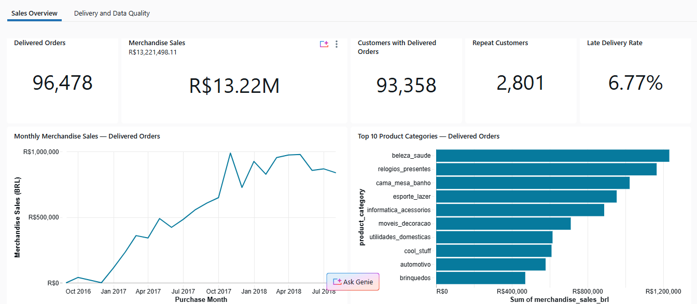
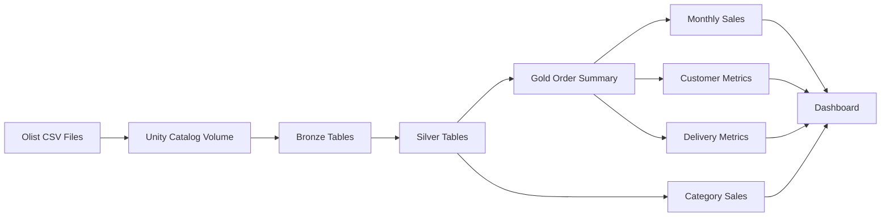
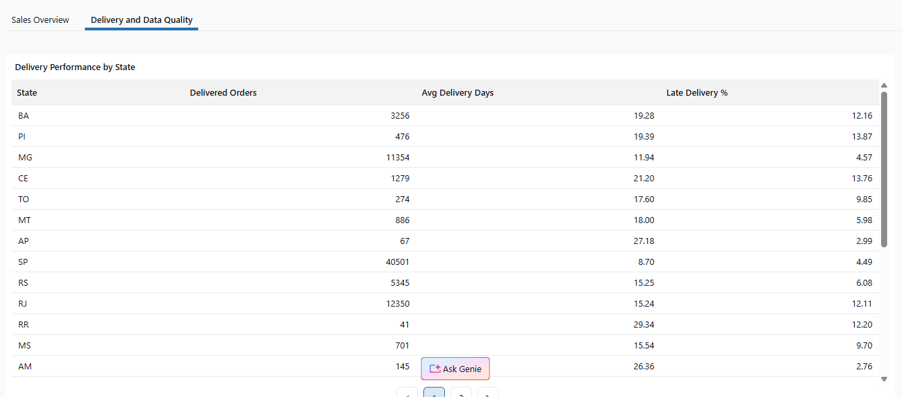

# Olist E-Commerce Lakehouse

An end-to-end batch data pipeline built on Databricks to transform e-commerce source files into validated Delta tables and business reporting datasets.

The project processes orders, order items, products, customers, and payments through Bronze, Silver, and Gold layers. A 13-task workflow refreshes the tables in sequence and runs final validation checks.



## Business Questions

- How do merchandise sales change by purchase month?
- Which product categories generate the most merchandise sales?
- How many customers return for another delivered order?
- How does delivery performance vary across Brazilian states?

## Architecture



**Bronze:** preserves source fields as strings and adds an ingestion timestamp.

**Silver:** converts data types, standardizes selected fields, checks keys and relationships, and preserves unusual records with quality flags.

**Gold:** combines order-level data and creates reporting tables with explicit business definitions.

Lakeflow Jobs runs the notebooks sequentially. Each task depends on the previous task succeeding, and the final task validates the saved tables.

## Technology Stack

| Component | Technology |
|---|---|
| Platform | Databricks Free Edition |
| Processing | Python, PySpark, Spark SQL expressions |
| Storage | Delta Lake managed tables |
| Data organization | Unity Catalog and managed Volume |
| Compute | Serverless |
| Orchestration | Lakeflow Jobs |
| Reporting | Databricks dashboards |

## Source Data

The [Brazilian E-Commerce Public Dataset by Olist](https://www.kaggle.com/datasets/olistbr/brazilian-ecommerce) contains historical marketplace transactions from Brazil, covering 2016–2018.

This pipeline uses five source files:

| Dataset | Records | Record Key |
|---|---:|---|
| Orders | 99,441 | `order_id` |
| Order items | 112,650 | `order_id`, `order_item_id` |
| Products | 32,951 | `product_id` |
| Customers | 99,441 | `customer_id` |
| Payments | 103,886 | `order_id`, `payment_sequential` |

Download source files from the publisher. Raw data is not included in this repository. Reviews, sellers, geolocation, and category translations are outside the implemented scope.

## Engineering Decisions

### Preventing inflated financial totals

An order can contain multiple items and payment records. Joining these directly by order ID would multiply rows. The pipeline aggregates items and payments separately to one row per order before joining them to orders.

### Preserving incomplete records

Left joins retain all 99,441 orders in the Gold summary. Orders without item or payment records are flagged, and missing monetary amounts remain null rather than being replaced with zero.

### Handling money and dates

Monetary fields use decimal types with two decimal places. Source date strings are converted to timestamps, and delivery lateness is measured using calendar dates to avoid treating an estimated midnight timestamp as a precise delivery deadline.

### Keeping data quality issues visible

The pipeline preserves original values instead of inventing corrections. It flags 23 inconsistent shipping sequences and unusual payment values. Unknown product categories are retained as `unknown` in category reporting.

### Supporting repeatable snapshot refreshes

Table writes use `overwrite` for complete snapshot refreshes. Source-count guards and selected key checks run before writes, with additional reconciliation and saved-table validation throughout the pipeline.

## Reporting Results

The following metrics cover delivered orders in the supplied dataset:

| Metric | Result |
|---|---:|
| Delivered orders | 96,478 |
| Merchandise sales | BRL 13,221,498.11 |
| Customers with delivered orders | 93,358 |
| Repeat customers | 2,801 |
| Orders eligible for lateness checks | 96,470 |
| Late orders | 6,534 |
| Late delivery rate | 6.77% |

- Merchandise sales exclude freight and represent neither profit nor accounting net revenue.
- Repeat customers have at least two delivered orders within the observation period.
- Overall lateness is calculated as total late orders divided by total eligible orders, rather than averaging state percentages.
- Monthly sales use purchase month. Monthly customer counts and category order counts can overlap and must not be summed into full-period unique counts.

## Data Quality and Reconciliation

The completed Databricks run passed the final validation suite for expected table sizes, unique keys, and selected reporting totals.

Checks across the notebooks cover missing identifiers, duplicate keys, conversion null counts, numeric values, event sequences, and source relationships. Some checks report findings for inspection; others raise exceptions to stop execution.

Selected findings:

- 160 missing approval timestamps were preserved.
- 23 orders have customer delivery recorded before carrier handoff; these are excluded from carrier transit duration calculations.
- Eight delivered orders lack dates required for lateness checks.
- 610 products lack a category.
- Payments include two zero-installment records, nine zero-value records, and three undefined payment types. These flags overlap and are not additive.

All-status source-to-Gold financial reconciliation preserved:

| Measure | Total (BRL) |
|---|---:|
| Merchandise | 13,591,643.70 |
| Freight | 2,251,909.54 |
| Recorded payments | 16,008,872.12 |

Each measure is compared with its own source; payment totals are not assumed to equal merchandise plus freight.

## Repository Structure

```text
notebooks/     13 processing and validation notebooks
dashboard/     Exported dashboard definition
job/           Sequential job configuration template
screenshots/   Dashboard previews
docs/          Setup instructions, data model, and validation notes
```

| Notebooks | Purpose |
|---|---|
| 01–02 | Bronze and Silver orders |
| 03–04 | Bronze and Silver order items |
| 05–06 | Bronze and Silver products |
| 07–08 | Bronze and Silver customers |
| 09–10 | Bronze and Silver payments |
| 11 | Gold order summary |
| 12 | Monthly, category, customer, and delivery metrics |
| 13 | Saved-table validation and reconciliation |

## Run the Project

1. Create the `ecommerce` schema in the `workspace` catalog and a managed Volume named `raw_files`.
2. Upload the five original CSV files to `/Volumes/workspace/ecommerce/raw_files/`.
3. Import the 13 notebooks into a single workspace folder, preserving their numbered names.
4. Update the `YOUR_EMAIL` notebook paths in the job JSON to match that folder, and verify serverless compute settings in the target workspace.
5. Create the job using the configuration or recreate its sequential tasks in the Jobs UI. Keep maximum concurrent runs at one.
6. Run the pipeline and confirm notebook 13 finishes with `All checks in this validation suite passed.`
7. Import the dashboard definition, connect it to the Gold tables, and verify the reporting totals.

The notebooks require Databricks; they are not standalone local Python scripts. If a different catalog or schema is used, update table and Volume paths consistently.

See [setup instructions](docs/SETUP.md), [data model and metric definitions](docs/DATA_MODEL.md), and [validation review](docs/REVIEW.md).

## Dashboard

The dashboard includes sales and category views, customer KPI cards, and state-level delivery performance.



Clear active filters when viewing full-period KPIs. Cross-filtering monthly data can change some widgets while customer and delivery metrics remain full-period; the sales-card description is static. State-table sorting may depend on viewer settings.

## Scope and Limitations

- This is a historical batch snapshot pipeline, not streaming ingestion or change data capture.
- Expected counts are specific to the supplied Olist dataset and require review when inputs change.
- Individual Delta writes are transactional; the entire multi-table workflow is not atomic. A failed run can leave tables at different refresh stages.
- Source timestamps have no explicit time-zone offset. Parsing uses the workspace session time zone, which the notebooks do not explicitly configure.
- Coverage includes incomplete months. Observed repeat purchases are limited to the dataset period.
- The validation suite covers specified rules and reconciliation checks; it does not guarantee that every source value is accurate.

## Future Improvements

- Parameterize catalog, schema, and source paths.
- Add run IDs, audit tables, and stronger pre-write quality gates.
- Implement incremental ingestion with Delta MERGE.
- Add deployment automation and continuous integration.
- Define an explicit timestamp policy and align dashboard filter scopes.
