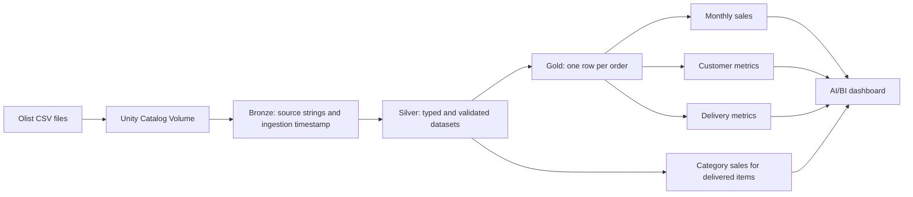

# Olist E-Commerce Lakehouse

A Databricks data engineering portfolio project that transforms five related e-commerce datasets into validated Delta tables and business reporting datasets. The pipeline uses 13 sequential notebook tasks and a two-page AI/BI dashboard.


## What this project demonstrates

- Bronze, Silver, and Gold data modeling in Unity Catalog.
- PySpark transformations, timestamp parsing, fixed-precision monetary values, and quality flags.
- Composite-key and relationship checks, plus financial reconciliation.
- Order-level aggregation before joins to prevent item/payment fan-out.
- Repeatable full-snapshot table refreshes and Lakeflow Jobs orchestration.
- Reporting definitions that distinguish sales, freight, and recorded payments.

## Architecture



Lakeflow Jobs runs notebooks 01–13 sequentially, with each task depending on the previous task's success. The final notebook checks saved table counts, unique keys, and reporting reconciliation.

## Stack

| Layer | Technology |
|---|---|
| Platform and compute | Databricks Free Edition, serverless |
| Processing | Python, PySpark, Spark SQL expressions |
| Storage and catalog | Delta Lake managed tables, Unity Catalog Volume |
| Orchestration | Lakeflow Jobs, 13 notebook tasks |
| Reporting | Databricks AI/BI dashboards |
| Repository assets | Jupyter notebooks, job JSON, dashboard JSON, Markdown |

## Data source and scope

Source: [Brazilian E-Commerce Public Dataset by Olist](https://www.kaggle.com/datasets/olistbr/brazilian-ecommerce), covering historical Brazilian marketplace orders from 2016–2018.

Download the data from its publisher and review the dataset's usage/license terms. Raw CSVs are not redistributed in this repository. The pipeline uses five of the nine supplied CSVs; reviews, sellers, geolocation, and category translations are outside the implemented scope.

| Source file | Records | Silver key |
|---|---:|---|
| `olist_orders_dataset.csv` | 99,441 | `order_id` |
| `olist_order_items_dataset.csv` | 112,650 | `order_id`, `order_item_id` |
| `olist_products_dataset.csv` | 32,951 | `product_id` |
| `olist_customers_dataset.csv` | 99,441 | `customer_id` |
| `olist_order_payments_dataset.csv` | 103,886 | `order_id`, `payment_sequential` |

`customer_unique_id` recognizes customers across purchases; `customer_id` is the relationship key from orders. Repetition of `customer_unique_id` is expected.

## Verified results

These are results reported from the original Databricks execution and shown in the dashboard; reproducing them requires running the supplied source dataset in Databricks.

| Delivered-order metric | Result |
|---|---:|
| Delivered orders | 96,478 |
| Merchandise sales, excluding freight | BRL 13,221,498.11 |
| Distinct customers with delivered orders | 93,358 |
| Customers with at least two delivered orders | 2,801 |
| Delivered orders eligible for lateness checks | 96,470 |
| Late orders | 6,534 |
| Overall late delivery rate | 6.77% |

The all-status Gold order summary retains 99,441 orders, including 775 without item records and one without payment records. Missing monetary values remain null, rather than being presumed zero.

## Repository

```text
notebooks/    13 numbered processing and validation notebooks
dashboard/    Importable dashboard definition
job/          Job JSON template; replace YOUR_EMAIL before use
screenshots/  Sales overview and delivery dashboard images
docs/         Setup, metric definitions, validation review, study guide
```

## Reproduce the project

Follow [the setup guide](docs/SETUP.md). It explains source upload, notebook import, job path configuration, execution, and dashboard import.

The notebooks assume `workspace.ecommerce` and `/Volumes/workspace/ecommerce/raw_files/`. Replace these consistently if using another catalog or schema. The job JSON is a template, not an automatically portable deployment bundle.

## Metric definitions

- Reporting metrics use **delivered orders**, grouped by purchase month where applicable.
- Merchandise sales sum item prices in BRL; they exclude freight and do not represent profit or accounting net revenue.
- Recorded payments are a separate measure; they are not forced to equal merchandise plus freight.
- Repeat customers have at least two delivered orders in the observed dataset; this is not a general retention or churn estimate.
- Lateness compares actual and estimated **calendar dates**. The overall rate uses summed late orders divided by summed eligible orders, not an average of state percentages.
- Category order counts overlap when an order contains more than one category. Monthly distinct customer counts also overlap across months; neither should be summed into a full-period unique count.

See [the data model and quality notes](docs/DATA_MODEL.md) for details.

## Validation and limitations

The user reported a successful 13-task Databricks job and a passing final validation notebook. Packaging checks parse notebook Python syntax and JSON and verify task dependencies; they do not execute Spark remotely.

- Full-snapshot `overwrite` refreshes are intentional. They are not incremental ingestion or CDC. Each Delta write is transactional, but the complete multi-table pipeline is not one atomic transaction; a failed run can leave tables at different refresh stages.
- The exact expected counts target this fixed dataset, not arbitrary future input.
- Some exploration/quality cells print findings rather than raise errors. The final suite is not comprehensive enforcement of every quality rule.
- Naive source timestamps are parsed with the workspace session time zone; the implementation does not explicitly configure it or establish an original source time zone. Durations use calendar dates.
- Dashboard cross-filtering can filter monthly-data widgets while other full-period datasets remain unchanged. Clear all filters for the full-period overview; a static sales-card description does not update with selections.
- Some state-table sorting can be viewer-specific; the included delivery screenshot is not sorted by order count.
- Eight delivered orders lack dates needed for lateness checks. Twenty-three orders have inconsistent shipping sequences; their carrier transit duration is left null.
- Category names remain Portuguese, with missing categories labeled `unknown`. Historical coverage includes incomplete months.
- The dashboard is an illustrative consumer of the pipeline, not a public live data service.

See [the packaging review](docs/REVIEW.md) for checks, adjustments, and follow-up opportunities.

## Dashboard


## Next improvements

Parameterize catalog and source paths; enforce all quality rules before writes; add run IDs and audit tables; introduce incremental MERGE ingestion; add automated deployment and CI checks; align dashboard filter scopes; explicitly define timestamp handling.

## Attribution

Dataset published by Olist on Kaggle. Built as a guided learning project with AI assistance; exported processing logic is preserved for review and further study. No code license is assigned in this package; choose one deliberately before offering reuse rights.
